<!-- HEADER -->
<p align="center">
  
</p>

<!-- Black text vanishes on GitHub's dark mode, so the typing line swaps colour with the theme. -->
<p align="center">
  <picture>
    <source media="(prefers-color-scheme: dark)" srcset="https://readme-typing-svg.demolab.com?font=Fira+Code&weight=700&size=22&pause=1000&color=FFD93D&center=true&vCenter=true&width=640&lines=Managers+create+events;Admins+approve+them;Students+register+in+seconds;Check+in+with+a+QR+ticket;Get+your+certificate+%F0%9F%8E%93" />
    
  </picture>
</p>

<p align="center">
  <a href="https://eventifys.vercel.app"></a>
  
  
  
</p>

<p align="center">
  <b>Event management for National University – Mall of Asia (NU MOA).</b><br/>
  Every college, the Student Council and offices such as Career Services run their events here.
</p>

<!-- docs/ images are captured with Playwright from a local copy running the seed demo data. -->
<p align="center">
  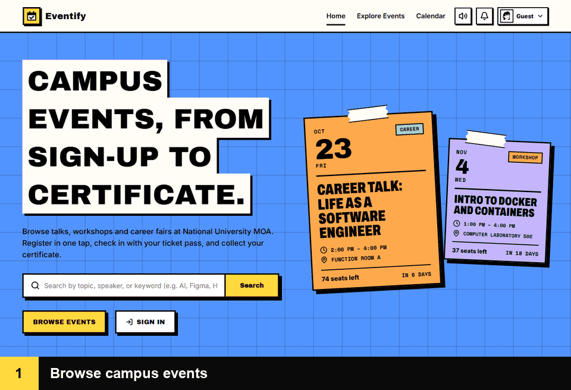
</p>

---

## ✨ Features

<table>
  <tr>
    <td width="50%" valign="top">
      <h3>🎟️ For attendees</h3>
      <ul>
        <li>Browse events by category or on the calendar</li>
        <li>Register and pick a seat on the seat map</li>
        <li>QR ticket for check-in and exit</li>
        <li>Certificates and feedback after the event</li>
      </ul>
      <br/>
    </td>
    <td width="50%" valign="top">
      <h3>🗂️ For event managers</h3>
      <ul>
        <li>Submit events for admin approval</li>
        <li>Venue booking with clash and capacity checks</li>
        <li>Session timeline, speakers and announcements</li>
        <li>Registrations, attendance and reports</li>
      </ul>
      <br/>
    </td>
  </tr>
  <tr>
    <td width="50%" valign="top">
      <h3>🛡️ For admins</h3>
      <ul>
        <li>Approve, reject or archive events</li>
        <li>Manage users, venues and platform settings</li>
        <li>Audit log of every change</li>
        <li>CSV reports across all events</li>
      </ul>
      <br/>
    </td>
    <td width="50%" valign="top">
      <h3>📷 For door staff</h3>
      <ul>
        <li>Scan tickets to check attendees in</li>
        <li>Rotating exit QR to verify who stayed</li>
        <li>Duplicate and too-early scans are refused</li>
      </ul>
      <br/>
    </td>
  </tr>
</table>

## 📸 The flow, step by step

<table>
  <tr>
    <td width="50%">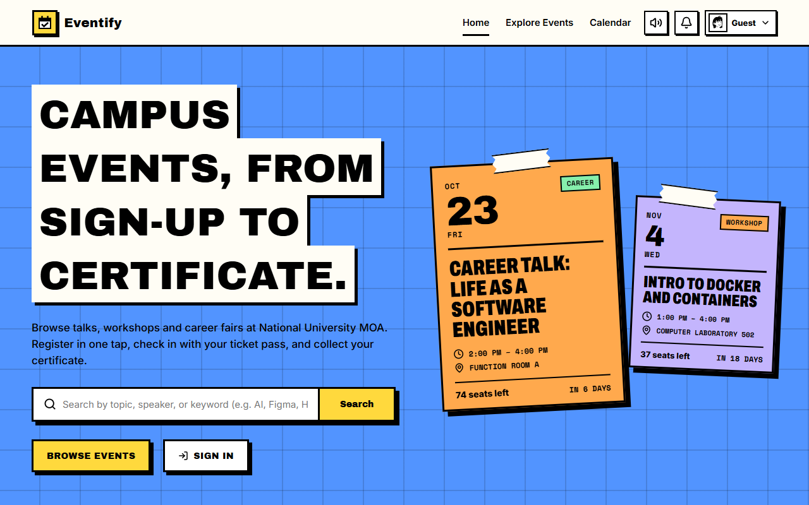<p align="center"><b>1 · Home</b><br/>What's coming up on campus</p></td>
    <td width="50%">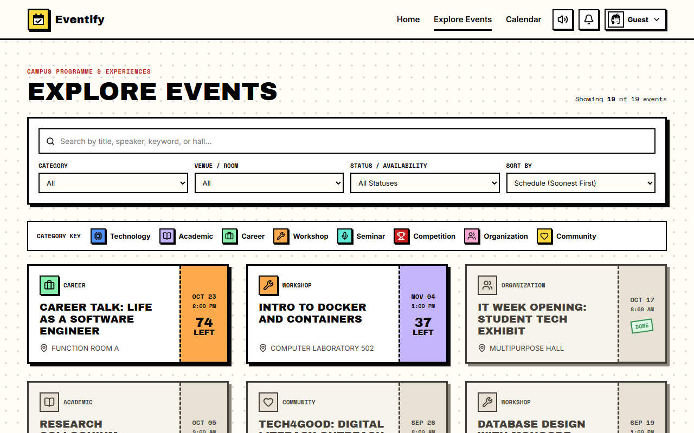<p align="center"><b>2 · Explore events</b><br/>Filter by category, venue and status</p></td>
  </tr>
  <tr>
    <td width="50%">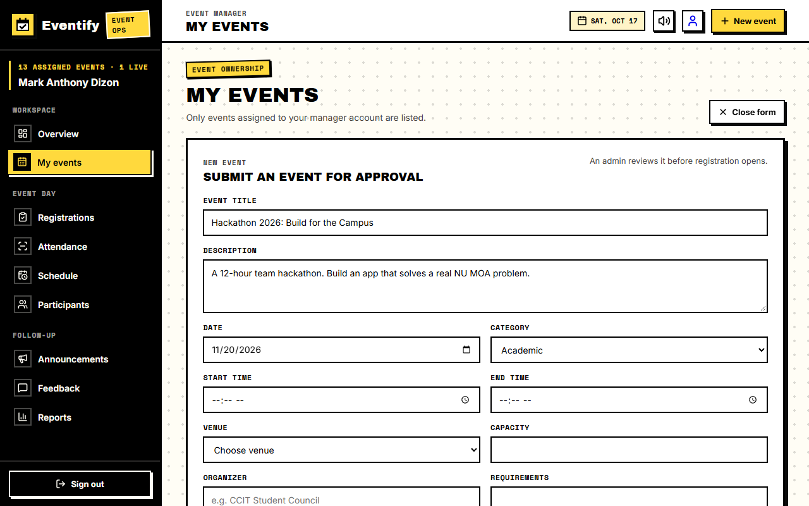<p align="center"><b>3 · Manager submits an event</b><br/>Venue, time and capacity are checked for clashes</p></td>
    <td width="50%">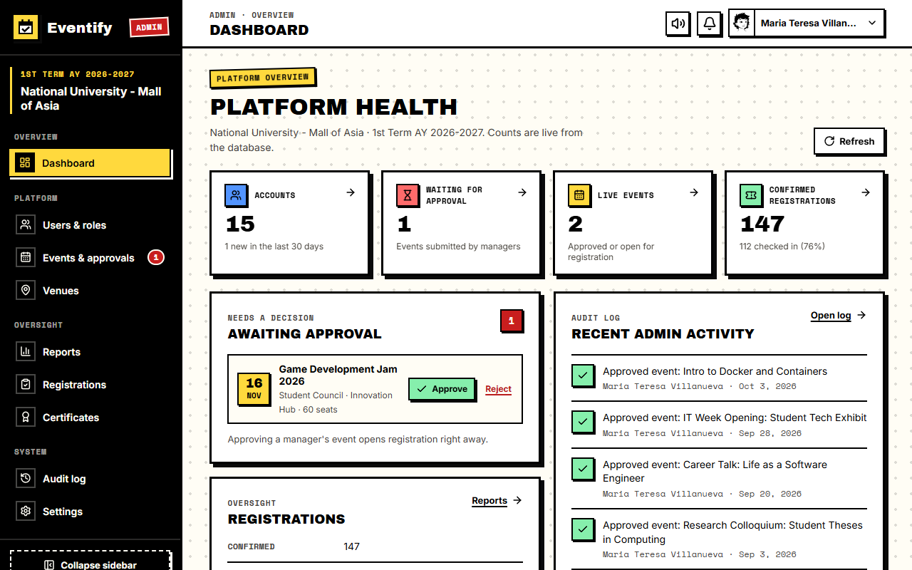<p align="center"><b>4 · Admin approves it</b><br/>Approving opens registration right away</p></td>
  </tr>
  <tr>
    <td width="50%">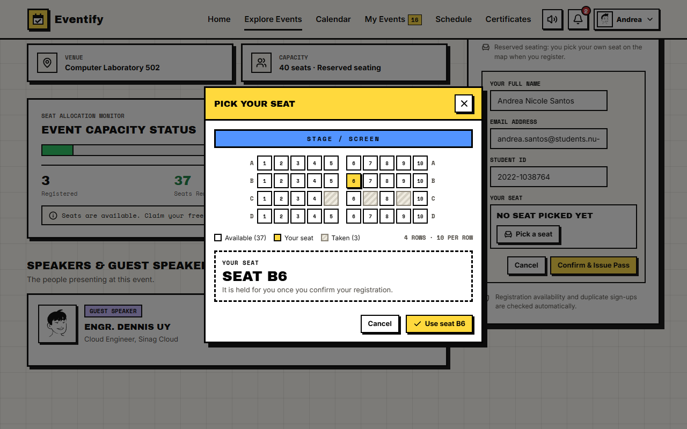<p align="center"><b>5 · Student registers</b><br/>Pick a seat on the seat map</p></td>
    <td width="50%">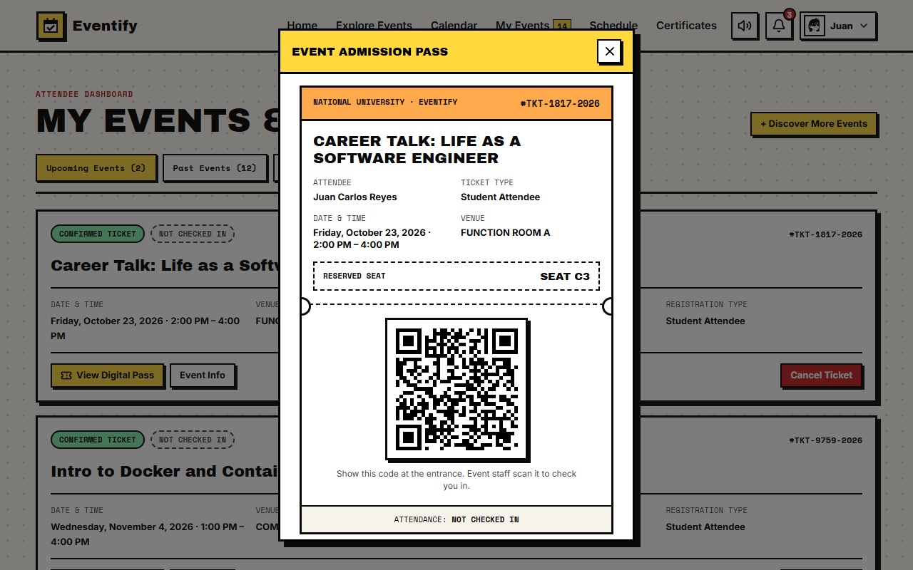<p align="center"><b>6 · QR ticket pass</b><br/>Shown at the door to check in</p></td>
  </tr>
  <tr>
    <td width="50%">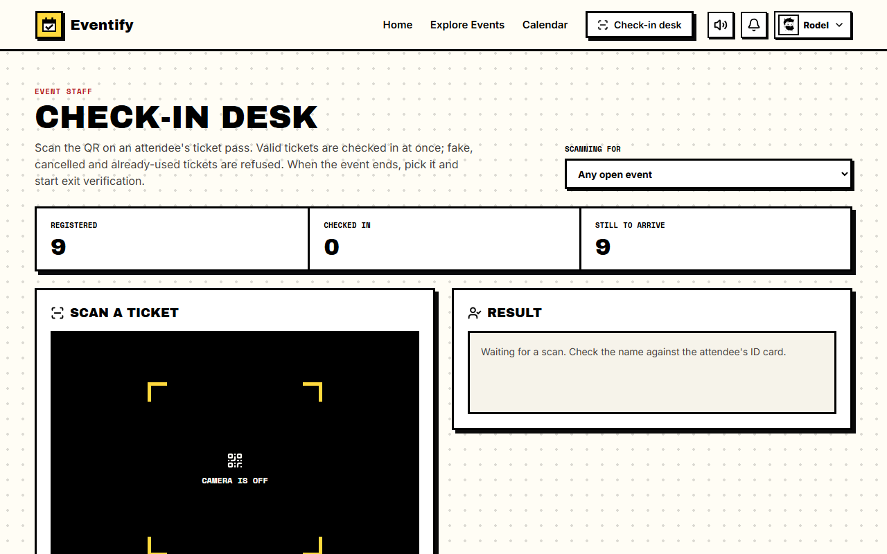<p align="center"><b>7 · Staff check-in desk</b><br/>Fake, cancelled and used tickets are refused</p></td>
    <td width="50%">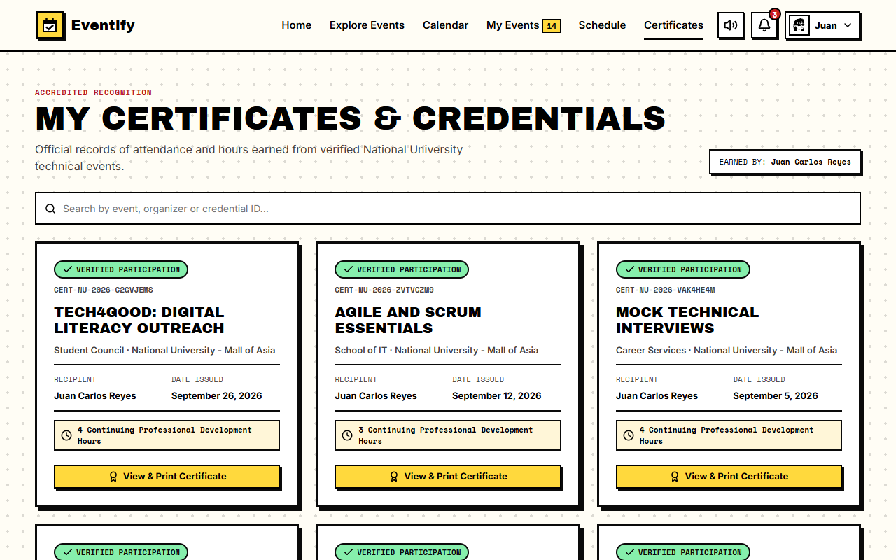<p align="center"><b>8 · Certificate</b><br/>Issued after the exit scan, with hours earned</p></td>
  </tr>
  <tr>
    <td colspan="2" align="center">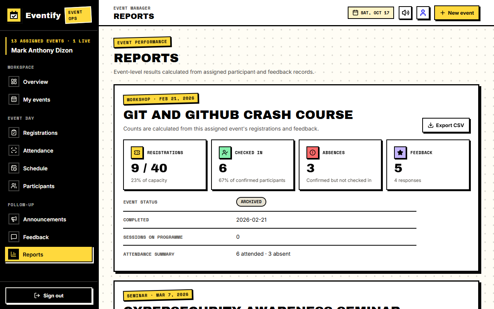<p align="center"><b>9 · Reports</b><br/>Registrations, attendance and feedback per event</p></td>
  </tr>
</table>

## 🔄 How an event flows

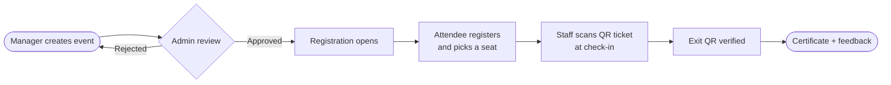

## 🧰 Built with

<p align="center">
  
</p>

> [!NOTE]
> A React app (this folder) talks to an Express + MongoDB server (`server/`). See [`SYSTEM_FLOW.md`](SYSTEM_FLOW.md) for how the parts work together.

## 🚀 Getting started

<details>
<summary><b>1. Clone and install</b></summary>

```bash
git clone https://github.com/Bibimbap67/eventify.git
cd eventify
npm install
npm --prefix server install
```

</details>

<details>
<summary><b>2. Set up the server</b></summary>

You need MongoDB, either installed locally or a free MongoDB Atlas database.

Create `server/.env` with at least these two lines:

```text
MONGODB_URI=mongodb://127.0.0.1:27017/eventify
JWT_SECRET=any-long-random-text
```

Optional: `PORT` (default 5000), `CLIENT_URL` (default https://eventifys.vercel.app; set it to http://localhost:3000 locally),
`JWT_EXPIRES_IN` (default 7d), and `SMTP_HOST`, `SMTP_PORT`, `SMTP_USER`, `SMTP_PASS`, `MAIL_FROM`
for password-reset emails (without them the reset link prints in the server console).

</details>

<details>
<summary><b>3. Load demo data (optional)</b></summary>

Add `SEED_ADMIN_EMAIL`, `SEED_ADMIN_PASSWORD` and `SEED_PASSWORD_SUFFIX` to `server/.env`, then:

```bash
npm --prefix server run seed
```

> [!WARNING]
> Seeding wipes every event, registration and non-admin account in that database first.

</details>

<details>
<summary><b>4. Run it</b></summary>

Start the server and the app in two terminals:

```bash
npm run server
```

```bash
npm start
```

The app runs at **http://localhost:3000**.

</details>

<details>
<summary><b>5. Run the tests</b></summary>

```bash
npm test
```

```bash
npm --prefix server test
```

> [!TIP]
> The server's data-rule tests need a local MongoDB (or `MONGODB_TEST_URI`). They use a throwaway
> `eventify_rules_test` database and are skipped when no MongoDB is running.

</details>

<!-- FOOTER -->
<p align="center">
  
</p>
